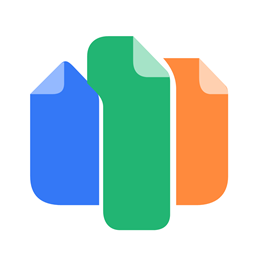

# Иконка TrineDocs — октябрь 2026

По запросу владельца: белый фон, современный минималистичный знак. Три сцепленных листа объединяют синий Docs, зелёный Sheets и оранжевый Slides. Детали текста удалены, форма читается в малом размере.

Векторный оригинал: [trinedocs.svg](../../crates/trinedocs/assets/trinedocs.svg). PNG 256×256 используется нативным окном; ICO содержит размеры16/20/24/32/40/48/64/128/256 для ресурсов Windows. Фон непрозрачный #FFFFFF. Ресурсные пути сохранены, существующий build.rs подхватит новый ICO при будущей разрешённой сборке.

Концепт создан встроенным imagegen и сохранён в [trinedocs-icon-concept.png](trinedocs-icon-concept.png). Затем знак переведён в редактируемые векторные кривые и растрирован штатным System.Drawing Windows; градиенты и шум генерации не перенесены. Новых runtime зависимостей, шрифтов и чужих логотипов нет.

Промпт: «Modern minimalist TrineDocs Windows app icon; white background; one cohesive mark of three interlocking document folds; blue/green/orange; no letters, tiny lines, shadows or3D». Уточнение: плоские цвета и чистый белый фон. Режим: встроенный imagegen, не CLI/API fallback.

Решения сверены с [Microsoft: App icons](https://learn.microsoft.com/en-us/windows/apps/design/iconography/app-icons): простая узнаваемая метафора и читаемость малого размера. Просмотр PNG и структуры ICO выполняется без сборки приложения. Полная Windows shell/display QA ждёт отдельной команды на сборку.
